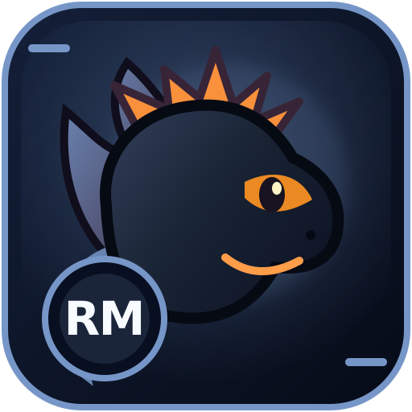

# repo-manager-ultimate — Dragon icon proposal



This is an **optional, original design asset** for the Infrastructure project, using accent colour `#7696c8` and the shared black-dragon/orange-eyes visual family.

To display the icon in this repository's top-level README **after approval**, reference:

```markdown

```

No existing README, source files, licenses, third-party names or logos have been replaced. The SVG is a design concept, not an application executable, official upstream logo, GitHub social-preview setting or claim of release readiness. Review upstream marks and project needs before wider adoption.
